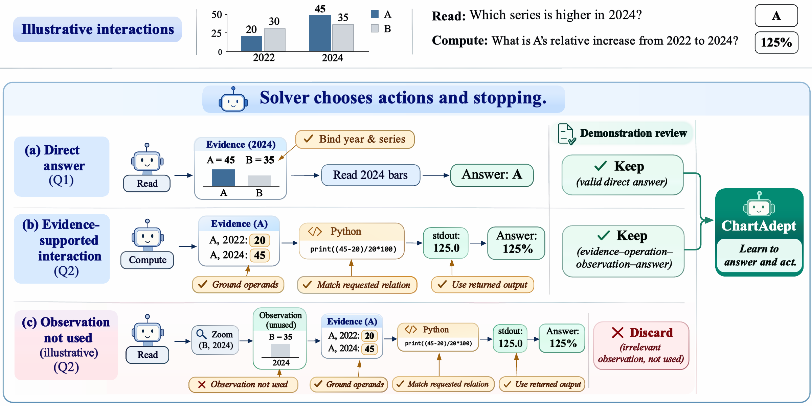
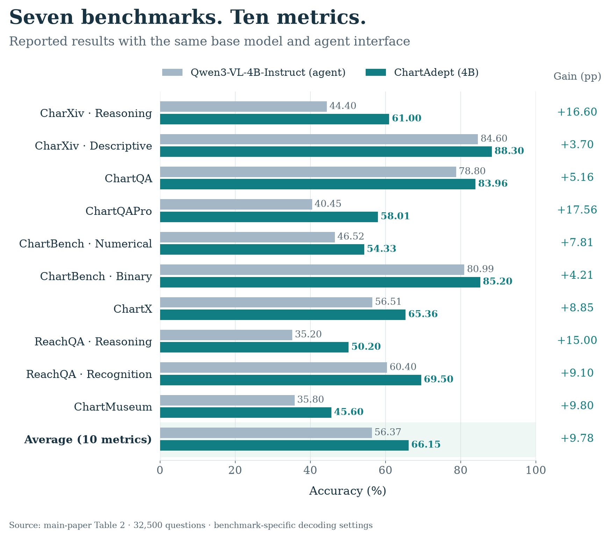
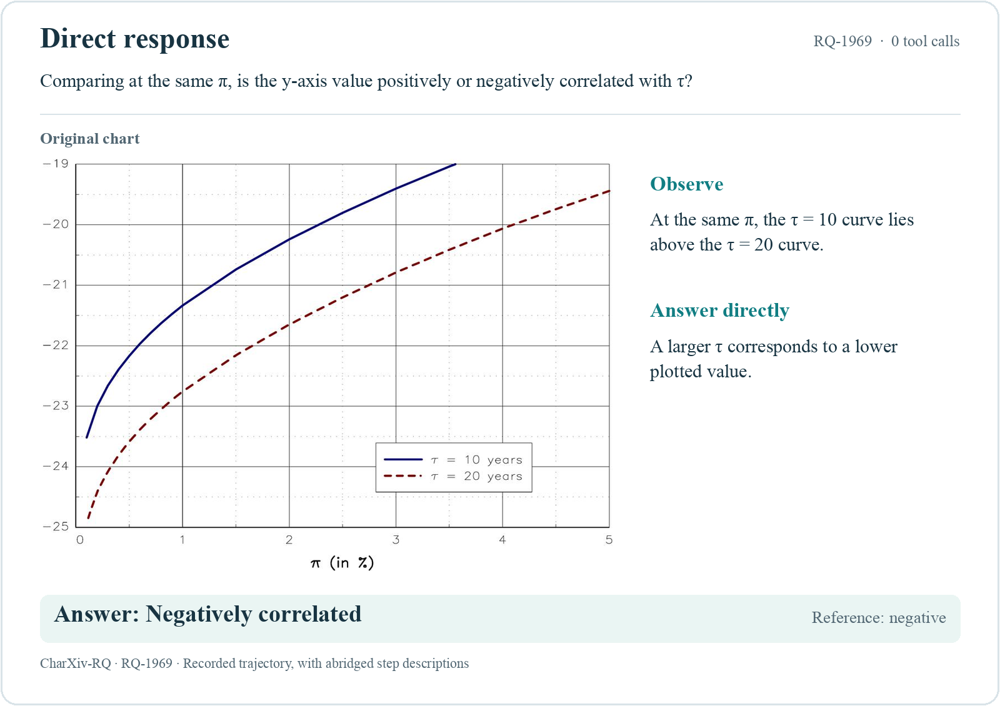
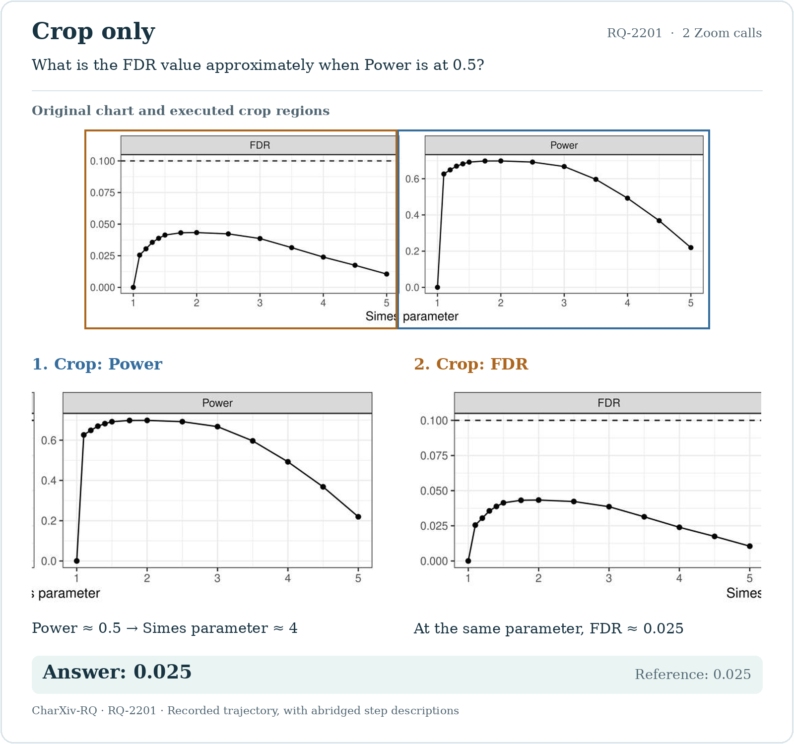
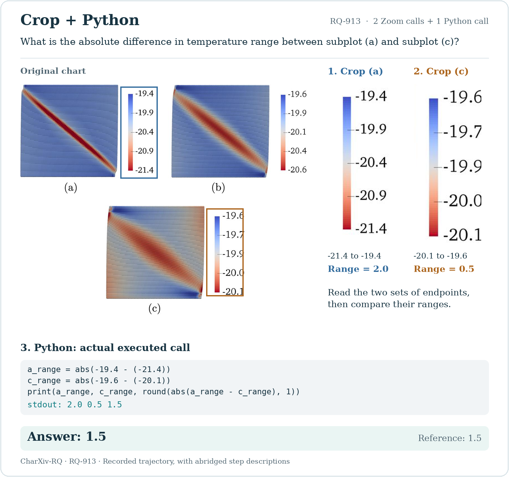

<h1 align="center">ChartAdept</h1>
<p align="center"><strong>Learning to Answer and Act with Verified Chart Trajectories</strong></p>
<p align="center">
  <a href="https://huggingface.co/TonyZhan/ChartAdept">🤗 Model weights</a> ·
  <a href="#results">Results</a> ·
  <a href="#examples">Visual examples</a> ·
  <a href="#installation-and-inference">Quickstart</a> ·
  <a href="CITATION.bib">Citation</a>
</p>

ChartAdept answers scientific-chart questions directly or obtains additional visual evidence with Zoom and Python. This repository provides training and inference implementations, the tool runtime, evaluation code, reported results, and three recorded qualitative examples.

[](docs/assets/paper-overview.pdf)

*Figure 1 from the paper: illustrative interactions and demonstration review. Click the image to view the original PDF.*

The paper's training corpus and its data construction and verification pipeline are not included in this release. Training entry points accept user-provided data. Training-reward scoring and benchmark evaluation are included.

## Results

**66.15% average accuracy** across ten metrics, **+9.78 percentage points** over the same Qwen3-VL-4B-Instruct base agent.



Values are from main-paper Table 2: 32,500 questions across seven benchmarks. The main agent protocol uses 16K greedy decoding; ChartMuseum uses the shared 32K, temperature-0.7 setting. [Full reported table](results/reported-main-table.csv) · [Evaluation protocol](docs/evaluation.md) · [Editable plot](docs/assets/results.svg)

## Model

The final [**TonyZhan/ChartAdept** checkpoint](https://huggingface.co/TonyZhan/ChartAdept) is the GSPO step-162 export based on `Qwen/Qwen3-VL-4B-Instruct`. It includes all four weight shards, tokenizer, image processor, and chat template. The original float32 export is approximately 19.3 GB; inference loads it in BF16.

## Installation and inference

Use Linux, Python 3.12, and a CUDA-capable NVIDIA GPU. The reference runtime uses CUDA 12.8 and 80 GB GPUs. Memory use depends on image size, generation length, and concurrency.

```bash
python3.12 -m venv .venv
source .venv/bin/activate
pip install -r requirements-inference.txt
pip install -e . --no-deps

hf download TonyZhan/ChartAdept --local-dir ../chartadept-model
python -m chartadept.serve --model ../chartadept-model --port 8237 --max-sequences 1
```

In another terminal using the same environment:

```bash
python -m chartadept.infer \
  --server http://127.0.0.1:8237 \
  --image /absolute/path/to/chart.png \
  --question "What is the difference between the two values?" \
  --output ../chartadept-runs/example
```

The output contains final predictions, model turns, tool arguments, and actual tool observations. `--mode direct` disables tools for a controlled comparison. The default autonomous mode can itself answer without a tool call.

| Preset | Output budget | Temperature | Final-answer reserve |
|---|---:|---:|---|
| `main` | 16,384 tokens across all turns | 0 | None |
| `museum` | 32,768 tokens across all turns | 0.7 | Up to 4,096 tokens within the total budget |
| `budget-control-32k` | 32,768 tokens across all turns | 0 | Up to 4,096 tokens within the total budget |

Use `--preset museum` for the main ChartMuseum setting. All agent presets permit at most twelve assistant turns and six tool calls. Python tool calls execute code in a child process; use an isolated working environment for model-generated code.

## Examples

All three examples use the **autonomous interface**. They show a direct response, crop-only reasoning, and a trajectory combining cropping with computation. The images, tool calls, and answers come from saved CharXiv-RQ evaluation records.

### Direct response



### Crop only



### Crop + Python



[`examples/qualitative`](examples/qualitative) contains the questions, saved responses, actual tool arguments, and stdout. The three input images are bundled with these illustrations under [CC BY-SA 4.0, with source attribution](docs/assets/README.md). The complete benchmark is available from [CharXiv](https://github.com/princeton-nlp/CharXiv).

<details>
<summary><strong>Run or replay these examples</strong></summary>

```bash
python scripts/prepare_examples.py --output ../chartadept-runs/examples

# Replay the recorded tools without calling a model.
python -m chartadept.replay_examples \
  --questions ../chartadept-runs/examples/questions.jsonl \
  --output ../chartadept-runs/replay

# Generate fresh answers with the released checkpoint server.
python -m chartadept.infer --server http://127.0.0.1:8237 \
  --questions ../chartadept-runs/examples/questions.jsonl \
  --output ../chartadept-runs/fresh-examples
```

To use separately downloaded CharXiv images, pass `--charxiv-images /path/to/CharXiv/images` to the preparation script.

</details>

## Training and evaluation

- [Training](docs/training.md): two SFT stages and GSPO on your own prepared data, with local and Ray runtimes.
- [Evaluation](docs/evaluation.md): question schema, complete-response Compass scoring, benchmark settings, and paired figure bootstrap.
- [Reported results](results/reported-main-table.json): manuscript Table 2 values, identified separately from newly generated evaluation outputs.

The training scripts and paper configurations are provided for adaptation. The private training corpus is required to repeat the original training run; the public ChartQA demonstration exercises the training interface on a different, small dataset.

## Checks

```bash
python -m unittest discover -s tests -v
python -m chartadept.train_sft initial --dry-run
python -m chartadept.train_rl gspo --dry-run
```

These are CPU checks of tools, the interaction loop, grading preparation, statistics, and configuration. They do not train the full model or reproduce benchmark accuracies.

## License and citation

Original code, the inference schematic, and the reported-results plot use [Apache 2.0](LICENSE). The CharXiv case illustrations and chart assets use **CC BY-SA 4.0**, with [attribution and modification notes](docs/assets/README.md). See [NOTICE](NOTICE) for upstream projects. Use [CITATION.bib](CITATION.bib) to cite the manuscript.
